# Roteiro para apresentar os experimentos de seleção de atributos

Este roteiro acompanha a evolução de dois para três objetivos, as duas rodadas com árvore de decisão e a rodada com MLP. A finalidade é explicar cada escolha, localizar sua implementação e interpretar os resultados com segurança. As falas entre aspas são sugestões para você praticar com suas palavras.

**Situação conferida em 15/10/2026:** a árvore tem rodadas concluídas de 15 gerações com duas e três bases; os arquivos da MLP mostram resultado parcial na geração 53/100. Há gráficos de validação da MLP, mas não há `resultado_final.json`, `pareto_validacao.json`, `escolhas_antes_do_teste.json` ou `analise.concluida.json`. Esta constatação descreve os artefatos disponíveis, sem atestar se existe um processo de treinamento ativo.

## 1 Como conduzir a reunião

Reserve aproximadamente 45 a 60 minutos. Use a sequência abaixo e deixe perguntas aprofundadas para o bloco correspondente.

| Ordem | Assunto | Tempo sugerido |
| --- | --- | --- |
| 1 | Pergunta da pesquisa e evolução dos objetivos | 5 min |
| 2 | Dados, tratamentos e representação da solução | 8 min |
| 3 | Árvore com duas e três bases | 10 min |
| 4 | Leitura dos gráficos da árvore | 8 min |
| 5 | Protocolo e implementação da MLP | 10 min |
| 6 | Resultados parciais e gráficos da MLP | 8 min |
| 7 | Limitações, próximos passos e perguntas | 5 min |

Se tiver apenas 15 minutos, apresente as seções 2, 6, 7, 10, 13 e 17. Use os recortes restantes para responder às perguntas.

No VS Code, abra a pasta `multiobjective-ids-generalization`. Abra este Markdown e pressione **Ctrl+Shift+V** para visualizar o roteiro com figuras. Para demonstrar um código, use **Ctrl+P**, digite o caminho do arquivo e pressione Enter; depois use **Ctrl+G** e informe a linha indicada. Abra roteiro e código em grupos de editor lado a lado. Na versão HTML, as imagens aparecem no navegador e é possível imprimir em PDF.

**Abertura sugerida:**

> “Minha pesquisa investiga a seleção de atributos para detecção de intrusão. Comecei procurando um compromisso entre desempenho de transferência entre bases e quantidade de atributos. Depois ampliei o protocolo para uma MLP treinada com dados das três bases e acrescentei o tempo de inferência como terceiro objetivo. Vou separar as etapas porque elas respondem a perguntas diferentes.”

## 2 Definição do problema e passagem para três objetivos

### 2.1 O que o modelo precisa aprender

Um registro representa um fluxo de rede. Os atributos descrevem esse fluxo, por exemplo quantidade de bytes, pacotes e flags TCP. O rótulo `Attack` informa a classe verdadeira, incluindo tráfego benigno e categorias de ataque. A tarefa implementada é **classificação multiclasse supervisionada**: aprender com exemplos rotulados e prever a classe de outros registros.

`X` é a tabela de atributos de entrada; `y` é o vetor de rótulos. Um **atributo** é uma coluna, uma **amostra** é uma linha e uma **classe** é um valor possível de `y`.

O NSGA-II não é o classificador. Ele propõe seleções de colunas; a árvore ou a MLP é treinada para medir o valor de cada seleção. Os pesos internos da MLP são aprendidos pelo Adam, enquanto o NSGA-II procura quais atributos usar.

### 2.2 Os dois objetivos originais da árvore

Sendo `k` a quantidade selecionada e `d = 37` a quantidade candidata:

```text
f₁ = 1 − média dos F1-macro de todas as direções de transferência
f₂ = k / d
Minimizar f₁ e f₂
```

**Abra [Modulos/otimizacao.py, linha 109](../Modulos/otimizacao.py#L109).** Recorte literal das linhas 109 a 113:

```python
        # Eu normalizo a quantidade de features como no código fornecido.
        proporcao_features = numero_selecionadas / self.d

        # Eu entrego ao pymoo os dois objetivos que ele deve minimizar.
        out["F"] = [1.0 - f1_cross_medio, proporcao_features]
```

**Explique o recorte:** `numero_selecionadas / self.d` transforma a quantidade em proporção. `out["F"]` entrega os dois valores ao otimizador. Como a biblioteca minimiza, converto o F1, que quero aumentar, em `1 − F1`, que quero diminuir. A média cross é calculada antes desse recorte a partir das métricas direcionais.

**Fala sugerida:**

> “Na árvore, o primeiro objetivo resume o desempenho entre bases e o segundo mede a proporção de atributos usados. Não imponho antecipadamente uma soma com pesos para decidir uma solução única; busco alternativas de compromisso.”

### 2.3 Os três objetivos da MLP

```text
f₁ = 1 − F1-macro na validação conjunta
f₂ = k / d
f₃ = mediana do tempo de padronização e previsão por evento
Minimizar f₁, f₂ e f₃
```

**Abra [Modulos/busca_mlp.py, linha 48](../Modulos/busca_mlp.py#L48).** Recorte literal das linhas 48 a 51:

```python
            valor = dict(mascara=mascara.tolist(), k=k, treinamento=resumo,
                         validacao=validacao, tempo=tempo,
                         objetivos=[1-validacao['geral']['f1_macro'], k/self.dados.d,
                                    tempo['mediana_s']])
```

**Abra [Modulos/busca_mlp.py, linha 57](../Modulos/busca_mlp.py#L57).** Recorte literal das linhas 57 a 68:

```python
class ProblemaMLP(ElementwiseProblem):
    def __init__(self, avaliador):
        self.avaliador = avaliador
        super().__init__(n_var=avaliador.dados.d, n_obj=3, n_ieq_constr=1, xl=0., xu=1.)

    def _evaluate(self, x, out, *args, **kwargs):
        mascara = (np.asarray(x) >= .5).astype(int)
        if not mascara.any():
            out['F'], out['G'] = [1., 1., 1.], [1.]
            return
        out['F'] = self.avaliador.obter(mascara)['objetivos']
        out['G'] = [-1.]
```

**Explique o recorte:** `n_var` é o número de genes, `n_obj=3` declara os objetivos e `n_ieq_constr=1` declara uma restrição. `out['G'] > 0` torna a máscara vazia inviável; `out['G'] = [-1.]` indica uma seleção válida. Na árvore, a máscara vazia recebe a penalização `[1, 1]`; na MLP, há também restrição explícita.

**Por que acrescentar tempo:** o número de atributos é uma medida de tamanho da entrada, mas não substitui uma medição de custo. Dois modelos podem ter quantidades distintas de atributos e tempos semelhantes, ou a ordem de rapidez pode se inverter.

### 2.4 O que mudou além do número de objetivos

| Aspecto | Árvore | MLP |
| --- | --- | --- |
| Pergunta central | Transferência entre bases distintas | Classificação de registros reservados das três bases participantes |
| Treinamento cross/conjunto | Treina na origem e avalia no destino, por direção | Reúne as partes de treino das três bases |
| Desempenho na busca | Média dos F1 direcionais, com pesos iguais por direção | F1-macro da validação unida |
| Objetivos | Erro cross e proporção de atributos | Erro de validação, proporção de atributos e tempo |
| Gerações configuradas | 15 | 100 |
| Baseline | Árvore com 37 atributos | MLP com 37 atributos |
| Reserva final independente da seleção | Sem base externa reservada nessas rodadas | Partição de teste, acessada após fixar escolhas |

**Fala sugerida:**

> “A MLP representa um novo protocolo. Além de acrescentar tempo, alterei o treinamento e a avaliação. Por isso, um F1 maior na MLP não comprova que a arquitetura superou a árvore no mesmo problema.”

## 3 Dados utilizados e tratamentos

### 3.1 Bases e rodadas

| Rodada | Bases | Direções cross | Configuração |
| --- | --- | --- | --- |
| Árvore inicial | NF-UNSW-NB15-v2 e NF-ToN-IoT-v2 | 2 | `src/config.yaml` |
| Árvore ampliada | As duas anteriores e NF-CSE-CIC-IDS2018-v2 | 6 | `src/config_tres_datasets.yaml` |
| MLP conjunta | As três bases | Não usa transferências direcionais como objetivo | `src/config_mlp_conjunto.yaml` |

Com `n` bases há `n × (n − 1)` transferências direcionais. A→B e B→A são avaliações diferentes, pois mudam o treinamento e o destino.

| Base | Registros originais | Removidos | Válidos |
| --- | --- | --- | --- |
| UNSW-NB15 | 1986745 | 0 | 1986745 |
| ToN-IoT | 13135881 | 131 | 13135750 |
| CSE-CIC-IDS2018 | 18893708 | 253 | 18893455 |

As contagens acima constam tanto de `Resultados/tres_datasets_v1/checkpoints/dados_preprocessamento.json` quanto do resumo de preparação da MLP. Os executáveis usam todos os registros válidos; o subconjunto do benchmark da MLP serve somente para medir tempo. A MLP reúne **34.015.950 registros válidos**, 37 atributos e 31 rótulos no vocabulário conjunto.

### 3.2 Leitura dos dados

**Abra [Modulos/carregamento.py, linha 88](../Modulos/carregamento.py#L88).** Recorte literal das linhas 88 a 89:

```python
        if nrows is None:
            df = pd.read_parquet(caminho, columns=colunas_leitura)
```

**Explique:** não há limite de linhas nesse ramo. O carregador da árvore pode deixar de ler portas, TTL e `Label` porque já seriam descartados. A MLP lê os Parquets em lotes para controlar o uso de memória, em `Modulos/dados_mlp.py`, função `preparar`.

### 3.3 Remoção de valores inválidos

**Abra [Modulos/preprocessamento.py, linha 27](../Modulos/preprocessamento.py#L27).** Recorte literal das linhas 27 a 42:

```python
    limite_float32 = np.finfo(np.float32).max
    linhas_validas = np.ones(len(df), dtype=bool)

    # Eu percorro uma coluna por vez para não criar uma segunda matriz com
    # milhões de linhas somente para verificar os limites numéricos.
    for coluna in df.columns:
        serie = df[coluna]
        if is_numeric_dtype(serie.dtype):
            valores = serie.to_numpy(copy=False)
            linhas_validas &= np.isfinite(valores)
            linhas_validas &= valores <= limite_float32
            linhas_validas &= valores >= -limite_float32
        else:
            linhas_validas &= serie.notna().to_numpy()

    return df.loc[linhas_validas].reset_index(drop=True)
```

**Explique passo a passo:** começa supondo todas as linhas válidas; em cada coluna verifica valores finitos e representáveis em `float32`; nas colunas não numéricas verifica ausências; mantém somente as linhas que passaram em todas as verificações. Não há imputação nesse fluxo.

Na MLP, o filtro é aplicado aos atributos candidatos comuns e ao rótulo, durante a leitura em lotes:

**Abra [Modulos/dados_mlp.py, linha 86](../Modulos/dados_mlp.py#L86).** Recorte literal das linhas 86 a 92:

```python
            numericos = df[atributos].to_numpy(dtype=np.float64)
            rotulos = df[pre['coluna_rotulo']].astype('string').str.strip().str.casefold()
            ok = (np.isfinite(numericos).all(axis=1)
                  & (np.abs(numericos) <= np.finfo(np.float32).max).all(axis=1)
                  & rotulos.notna().to_numpy() & rotulos.ne('').fillna(False).to_numpy())
            X = numericos[ok].astype('float32')
            X[X == 0] = 0  # Eu unifico +0 e -0 na identificação das duplicatas.
```

**Fala sugerida:**

> “Removo entradas numericamente inválidas antes do treinamento e registro quantas foram removidas. Trabalhar em lotes muda a forma de carregar os dados, mas não significa subamostrar os exemplos do treinamento.”

### 3.4 Exclusão de colunas e normalização dos rótulos

**Abra [src/config_mlp_conjunto.yaml, linha 13](../src/config_mlp_conjunto.yaml#L13).** Recorte literal das linhas 13 a 16:

```yaml
preprocessamento:
  atributos_vazamento: [L4_SRC_PORT, L4_DST_PORT, MIN_TTL, MAX_TTL]
  coluna_rotulo: Attack
  coluna_binaria: Label
```

**Abra [Modulos/preprocessamento.py, linha 62](../Modulos/preprocessamento.py#L62).** Recorte literal das linhas 62 a 68:

```python
    y = df[coluna_rotulo].astype("string").str.strip().str.casefold()
    X = df.drop(columns=[c for c in (coluna_rotulo, coluna_binaria) if c in df.columns])
    # Garanto matriz exclusivamente numérica: qualquer coluna não numérica
    # remanescente (ex.: identificador esquecido) é descartada com aviso
    # implícito via lista de colunas resultante.
    X = X.select_dtypes(include=[np.number])
    return X, y
```

`Attack` é o alvo. `Label` é outro rótulo e precisa ficar fora de `X` para evitar vazamento direto. Portas e TTL são excluídos por serem possíveis atalhos associados ao cenário de captura. Essa decisão reduz esse risco específico; ela não demonstra ausência de todo vazamento.

`str.strip()` remove espaços nas extremidades; `str.casefold()` uniformiza capitalização. Isso aproxima `DoS` de `dos`, mas não equivale a harmonizar semanticamente todas as taxonomias. `dos` e `dos attacks-hulk`, por exemplo, continuam categorias diferentes.

### 3.5 Mesmos atributos e mesma ordem

**Abra [Modulos/preprocessamento.py, linha 103](../Modulos/preprocessamento.py#L103).** Recorte literal das linhas 103 a 113:

```python
    colunas_comuns = None
    for X, _ in bases_Xy.values():
        cols = set(X.columns)
        colunas_comuns = cols if colunas_comuns is None else (colunas_comuns & cols)

    # Ordem determinística (ordem de aparição na primeira base) para a
    # máscara ser reprodutível entre execuções
    primeira = next(iter(bases_Xy.values()))[0]
    ordem = [c for c in primeira.columns if c in colunas_comuns]

    return {nome: (X[ordem].copy(), y) for nome, (X, y) in bases_Xy.items()}, ordem
```

**Explique:** faz a interseção das colunas e preserva a ordem da primeira base. Sem essa etapa, a terceira posição da máscara poderia significar atributos diferentes em cada dataset. A MLP também calcula a interseção, pelos schemas dos Parquets, em `preparar`.

## 4 Como o NSGA-II representa e avalia uma solução

### 4.1 Máscara de seleção

Exemplo didático com quatro atributos, que não representa uma solução real salva:

```text
Atributos: [IN_BYTES, IN_PKTS, OUT_BYTES, TCP_FLAGS]
Genes:     [0,80,     0,20,    0,60,      0,10]
Máscara:   [1,        0,       1,         0]
Resultado: selecionar IN_BYTES e OUT_BYTES; k = 2
```

**Abra [Modulos/otimizacao.py, linha 59](../Modulos/otimizacao.py#L59).** Recorte literal das linhas 59 a 67:

```python
    def decidir_features_mantidas(self, x):
        """Eu devolvo os índices cujos genes atingiram o limiar de 0,5."""
        return np.where(np.asarray(x) >= 0.5)[0]

    def criar_mascara_binaria(self, x):
        """Eu converto os genes contínuos para a máscara usada nas bases."""
        mascara = np.zeros(self.d, dtype=int)
        mascara[self.decidir_features_mantidas(x)] = 1
        return mascara
```

**Explique:** os genes são valores contínuos entre zero e um. O limiar 0,5 transforma os genes em decisões de manter ou remover. Portanto, a implementação usa o NSGA-II com genes contínuos convertidos em máscaras; não configura operadores binários especializados. Genes diferentes podem produzir a mesma máscara, e o cache evita repetir avaliações dessa seleção.

### 4.2 Dominância e fronteira

Uma solução A domina B se A é pelo menos tão boa em todos os objetivos e estritamente melhor em pelo menos um. Na minimização, isso significa valores menores ou iguais em todos e menor em algum. Se A usa menos atributos mas tem erro maior, pode haver um compromisso, sem dominância.

O NSGA-II classifica a população em frentes de não dominância e usa diversidade para escolher sobreviventes. Cruzamento e mutação geram novos candidatos. O código usa os operadores padrão da biblioteca; configurei explicitamente população, gerações e seed. Não avalio exaustivamente todas as combinações: com 37 atributos, há `2³⁷ − 1 = 137.438.953.471` máscaras não vazias.

**Abra [Modulos/otimizacao.py, linha 140](../Modulos/otimizacao.py#L140).** Recorte literal das linhas 140 a 140:

```python
    algoritmo = NSGA2(pop_size=n_pop)
```

**Abra [Modulos/otimizacao.py, linha 150](../Modulos/otimizacao.py#L150).** Recorte literal das linhas 150 a 158:

```python
    res = minimize(
        problema,
        algoritmo,
        ("n_gen", n_gen),
        seed=seed,
        verbose=verbose,
        save_history=False,
        **kwargs_minimize,
    )
```

`("n_gen", n_gen)` configura a parada por gerações. A seed controla os sorteios, mas uma única seed não mede estabilidade entre execuções. A fronteira final contém os compromissos encontrados e sobreviventes nessa execução; não prova que contém o ótimo global ou todas as soluções não dominadas já visitadas.

**Fala sugerida:**

> “O algoritmo devolve um conjunto de opções. Para escolher uma delas, ainda preciso explicitar minha preferência entre desempenho, tamanho e, no novo protocolo, tempo.”

## 5 Protocolo da árvore de decisão e seu baseline

### 5.1 Classificador

**Abra [Modulos/classificadores.py, linha 15](../Modulos/classificadores.py#L15).** Recorte literal das linhas 15 a 19:

```python
        return DecisionTreeClassifier(
            max_depth=8,
            class_weight="balanced",
            random_state=seed,
        )
```

`max_depth=8` limita a profundidade da árvore. `class_weight="balanced"` aumenta a influência relativa de classes menos frequentes no treinamento. `random_state=seed` fixa o estado aleatório. A árvore aprende comparações de limiares; o pipeline utiliza os valores originais, sem padronização.

### 5.2 Avaliação cross durante a busca

**Abra [Modulos/avaliacao.py, linha 129](../Modulos/avaliacao.py#L129).** Recorte literal das linhas 129 a 154:

```python
    for nome_i in nomes:
        for nome_j in nomes:
            if nome_i == nome_j:
                continue
            X_i, y_i = bases_Xy[nome_i]
            X_j, y_j = bases_Xy[nome_j]

            X_tr = aplicar_mascara(X_i, mascara)
            X_te = aplicar_mascara(X_j, mascara)

            # Eu uso exatamente as features selecionadas, sem reescalonar.
            classes_treino = np.unique(y_i)
            modelo = criar_classificador(nome_clf, seed=seed)
            _treinar(modelo, X_tr, _codificar_rotulos(y_i, classes_treino))

            # Tempo médio de inferência POR AMOSTRA (linha 12)
            inicio = time.perf_counter()
            y_pred = _prever(modelo, X_te)
            duracao = time.perf_counter() - inicio
            tempos_inferencia.append(duracao / max(len(X_te), 1))

            y_te_cod = _codificar_rotulos(y_j, classes_treino)
            f1 = f1_score(y_te_cod, y_pred, average="macro", zero_division=0)

            # Registro por direção de transferência (linha 9)
            resultados[f"{nome_i}->{nome_j}"] = float(f1)
```

**Explique o fluxo:** percorre pares de bases; pula a mesma origem e destino; aplica a mesma máscara nas duas; treina com todos os exemplos válidos da origem; prevê o destino; registra o F1 de cada direção. Os dois objetivos usam a média desses F1 e `k/d`.

O tempo já era **medido e registrado** na árvore, mas **não integrava o vetor de objetivos**. A inclusão do terceiro objetivo na MLP transforma uma medida complementar em critério efetivamente otimizado.

### 5.3 Avaliação detalhada dentro de cada base

**Abra [Modulos/avaliacao.py, linha 79](../Modulos/avaliacao.py#L79).** Recorte literal das linhas 79 a 79:

```python
    skf = StratifiedKFold(n_splits=cv_folds, shuffle=True, random_state=seed)
```

Validação cruzada estratificada com cinco folds: divide a base em cinco partes, preservando aproximadamente a distribuição de classes; treina em quatro e avalia na restante; repete até cada parte ter sido avaliada. O F1 intra é a média dos cinco resultados. As barras de erro nas figuras são o **desvio padrão entre folds**, calculado com `ddof=1`, e não intervalos de confiança.

Essa etapa é feita para as soluções finais e para o baseline. Não é executada para cada indivíduo da busca porque o F1 intra não faz parte dos dois objetivos.

### 5.4 De onde vem o baseline da árvore

**Abra [src/algoritmo2_avaliacao.py, linha 66](../src/algoritmo2_avaliacao.py#L66).** Recorte literal das linhas 66 a 68:

```python
    if args.mascara == "cheia":
        # Baseline: todos os atributos selecionados (k(x) = d)
        return [(0, np.ones(d, dtype=int))]
```

**Resposta pronta ao orientador:**

> “O baseline é uma referência experimental calculada pelo meu código: a mesma árvore com todos os 37 atributos candidatos após os tratamentos. Uso os mesmos parâmetros e a mesma avaliação das soluções selecionadas. Ele permite examinar o efeito da seleção em relação ao uso do conjunto completo.”

O baseline tem F1 intra e F1 em cada transferência; sua média cross depende das direções incluídas. Não é uma referência numérica externa importada de artigo, nem uma segunda arquitetura.

### 5.5 Classes do destino ausentes no treino

**Abra [Modulos/avaliacao.py, linha 68](../Modulos/avaliacao.py#L68).** Recorte literal das linhas 68 a 69:

```python
    indice = {c: i for i, c in enumerate(classes)}
    return np.array([indice.get(v, -1) for v in y])
```

No cross, a codificação usa as classes da origem. Categorias do destino que não existem na origem recebem `-1`. O modelo não aprendeu a prever `-1`; por isso essas amostras não são acertadas nessa implementação. O F1 agrega categorias desconhecidas em um único código, e não calcula um F1 separado para cada categoria desconhecida original.

**Fala sugerida:**

> “Parte da dificuldade decorre de classes que não aparecem no treinamento da origem. Também há erros em classes conhecidas, mas essa separação não identifica sozinha a causa desses erros. Para afirmar mudança de distribuição como causa, eu precisaria de análise adicional.”

## 6 Resultados da árvore com duas bases

Fonte do Pareto: `Resultados/pareto/pareto_20260907_000921_decision_tree.json`. O nome identifica o início da execução; não deve ser interpretado automaticamente como data de término.

Configuração: população 24, 15 gerações e seed 42. Há uma solução final única após remover máscaras repetidas e duas avaliações detalhadas no pacote: solução e baseline.

| Alternativa | Atributos | UNSW→ToN | ToN→UNSW | F1 cross médio |
| --- | --- | --- | --- | --- |
| Baseline | 37 | 0,016712 | 0,077545 | 0,047128 |
| S1 | 3 | 0,054537 | 0,079990 | 0,067264 |

S1 utiliza `SERVER_TCP_FLAGS`, `TCP_WIN_MAX_IN` e `DNS_QUERY_ID`. A redução é de 91,89%, calculada por `100 × (1 − 3/37)`.

**Fala sugerida:**

> “Nesta rodada, encontrei uma seleção de três atributos cuja média cross foi superior ao baseline com 37. A redução é expressiva, mas os F1 absolutos continuam baixos e os dados de transferência participaram da seleção. Apresento isso como resultado exploratório de seleção, sem tratá-lo como avaliação externa independente.”

O hipervolume aumentou de **0,100282 para 0,170428**. Ainda cresceu aproximadamente **0,003375 na última geração**; terminar 15 gerações não demonstra estabilização.

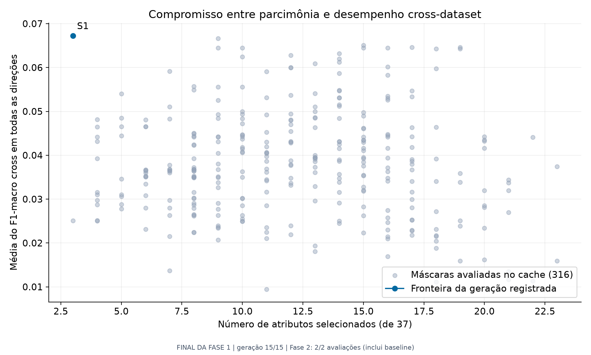

**Leitura:** horizontal = quantidade de atributos, menor é melhor; vertical = F1 cross médio, maior é melhor. Pontos cinza são máscaras do cache; o azul identifica a fronteira da geração salva. Uma única solução na fronteira final não implica que exista somente uma seleção útil entre todas as combinações possíveis.

## 7 Resultados da árvore com três bases

Fonte: `Resultados/tres_datasets_v1/pareto/pareto_20260910_053058_decision_tree.json`. Mantém população 24, 15 gerações e seed 42. A nova busca incorpora seis transferências e produz quatro soluções finais distintas, com cinco avaliações detalhadas incluindo o baseline.

| Alternativa | Atributos | Redução | F1 cross médio |
| --- | --- | --- | --- |
| Baseline | 37 | 0,00% | 0,035290 |
| S1 | 7 | 81,08% | 0,046460 |
| S2 | 8 | 78,38% | 0,058466 |
| S3 | 11 | 70,27% | 0,058526 |
| S4 | 12 | 67,57% | 0,061615 |

**Como explicar:** S1 é a mais compacta; S4 tem a maior média cross entre as quatro; S2 usa oito atributos e fica muito próxima do desempenho médio de S3, com onze. S2 e S3 não são idênticas: a diferença numérica de F1 é pequena, mas positiva para S3. O ganho de S4 sobre o baseline é aproximadamente **0,026324 na escala de F1**, sem estabelecer significância estatística.

### 7.1 Por que abrir as direções em vez de mostrar somente a média

| Direção | Baseline | S2 com 8 atributos | S4 com 12 atributos |
| --- | --- | --- | --- |
| UNSW-NB15->ToN-IoT | 0,016712 | 0,023226 | 0,068919 |
| UNSW-NB15->CSE-CIC-IDS2018 | 0,016091 | 0,084913 | 0,096281 |
| ToN-IoT->UNSW-NB15 | 0,077545 | 0,079008 | 0,055070 |
| ToN-IoT->CSE-CIC-IDS2018 | 0,030505 | 0,049755 | 0,031116 |
| CSE-CIC-IDS2018->UNSW-NB15 | 0,058885 | 0,085746 | 0,085172 |
| CSE-CIC-IDS2018->ToN-IoT | 0,012004 | 0,028148 | 0,033129 |

**Fala sugerida:**

> “S4 apresenta a maior média, mas perde para o baseline na direção ToN→UNSW. S2 supera numericamente o baseline nas seis direções desta execução. Logo, escolher só pela média esconde uma perda importante e a preferência depende da finalidade do detector.”

### 7.2 Desempenho dentro e fora das bases

| Base | F1 intra baseline | F1 intra S4 |
| --- | --- | --- |
| NF-UNSW-NB15-v2 | 0,472851 | 0,407256 |
| NF-ToN-IoT-v2 | 0,719982 | 0,651292 |
| NF-CSE-CIC-IDS2018-v2 | 0,619720 | 0,572915 |

S4 melhora a média cross, mas reduz o F1 intra nas três bases em comparação com o baseline. Isso evidencia um compromisso. Intra e cross também diferem no vocabulário de classes considerado, portanto a diferença não mede isoladamente uma mudança de distribuição.

## 8 Como explicar cada gráfico da árvore

Os pacotes ficam em `Resultados/figuras/orientadores_final/` para duas bases e `Resultados/tres_datasets_v1/figuras/` para três. Ambos são gerados por `src/relatorio_orientadores.py`, função `gerar`, e têm a mesma família de figuras. Os exemplos abaixo usam três bases.

### 8.1 Hipervolume e evolução da busca

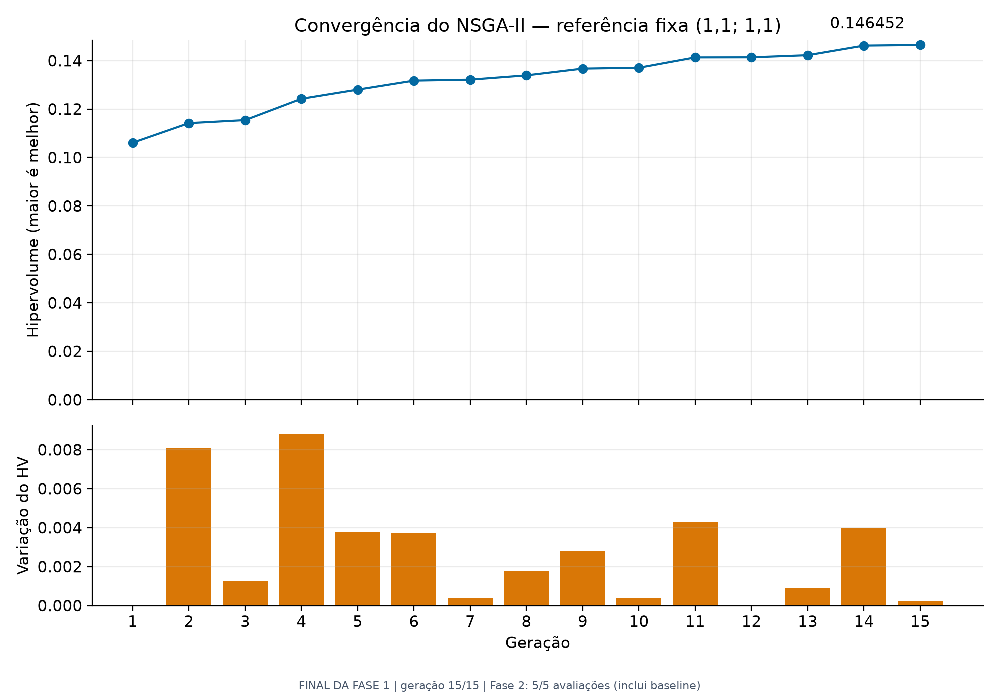

**Como ler:** horizontal = geração; painel superior = hipervolume da frente sobrevivente; painel inferior = diferença entre gerações consecutivas. Maior hipervolume significa melhor cobertura dos compromissos considerando a referência fixa, não porcentagem de acerto.

O hipervolume mede a região dominada pelas soluções até um ponto de referência pior, aqui `(1,1; 1,1)` em notação decimal portuguesa, correspondente a `[1.1, 1.1]` no Python. É calculado com os objetivos de minimização, mesmo que o Pareto seja desenhado em F1 crescente.

Na árvore com três bases, vai de **0,106119 para 0,146452** e a última variação é aproximadamente **+0,000254**. A curva não sustenta afirmar convergência comprovada.

**Abra [src/diagnostico_nsga2.py, linha 35](../src/diagnostico_nsga2.py#L35).** Recorte literal das linhas 35 a 41:

```python
    def registrar(alg):
        F = np.atleast_2d(alg.opt.get('F'))
        mascaras = (np.atleast_2d(alg.opt.get('X')) >= .5).astype(int)
        historico.append(dict(geracao=int(alg.n_gen), avaliacoes=int(alg.evaluator.n_eval),
                              hipervolume=float(hv(F)),
                              solucoes_unicas=len(np.unique(mascaras, axis=0)),
                              objetivos=F.tolist(), mascaras=mascaras.tolist()))
```

O histórico da árvore foi reconstruído por replay com cache somente leitura, e o código confere a fronteira reconstruída contra a salva. Não houve novo treinamento para obter essa curva. O valor é da população sobrevivente por geração, não de um arquivo acumulado de todos os pontos. Pode oscilar. Não compare numericamente HV de duas e três bases como se a tarefa fosse a mesma.

### 8.2 Pareto de desempenho e quantidade de atributos

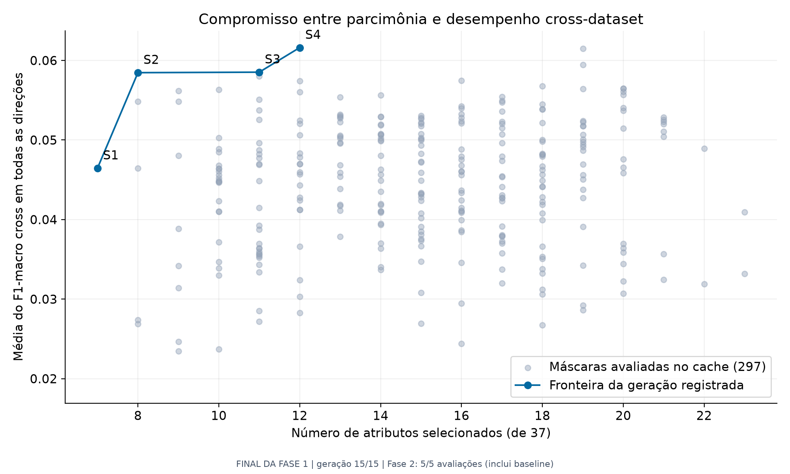

**Leia em voz alta:** “Cada ponto azul é uma seleção final: S1 tem sete atributos e F1 médio 0,046460; S4 tem doze e F1 médio 0,061615. Ir para a esquerda reduz atributos; ir para cima aumenta F1. As opções trocam compactação por desempenho.”

**Abra [src/relatorio_orientadores.py, linha 174](../src/relatorio_orientadores.py#L174).** Recorte literal das linhas 174 a 182:

```python
        ax.scatter([c['numero_atributos'] for c in cache],
                   [np.mean(list(c['f1_macro_cross_por_direcao'].values())) for c in cache],
                   color='#94a3b8', alpha=.45, s=25, label=f"Máscaras avaliadas no cache ({len(cache)})")
        ax.plot(ks,f1s,'o-',color='#0369a1',label='Fronteira da geração registrada')
        for s,k,f in zip(sols,ks,f1s):
            ax.annotate(s['id'],(k,f),xytext=(5,8),textcoords='offset points')
        ax.set(xlabel=f'Número de atributos selecionados (de {d})',ylabel='Média do F1-macro cross em todas as direções',
               title='Compromisso entre parcimônia e desempenho cross-dataset')
        ax.grid(alpha=.2); ax.legend(loc='lower right'); salvar(fig,'01_pareto')
```

**Explique:** cinza são avaliações no cache e azul é a fronteira da geração registrada. O cache não é a frente final: um ponto cinza pode ter sido avaliado e não sobrevivido. O baseline não é explicitamente marcado como ponto identificado nesse Pareto; a comparação com ele está nas métricas e em `06_intra_vs_cross`.

Os segmentos só unem pontos para facilitar leitura. Não são uma curva ajustada, não mostram soluções intermediárias medidas e não provam que toda a região da figura foi explorada.

### 8.3 Revisão dos eixos e candidato a joelho

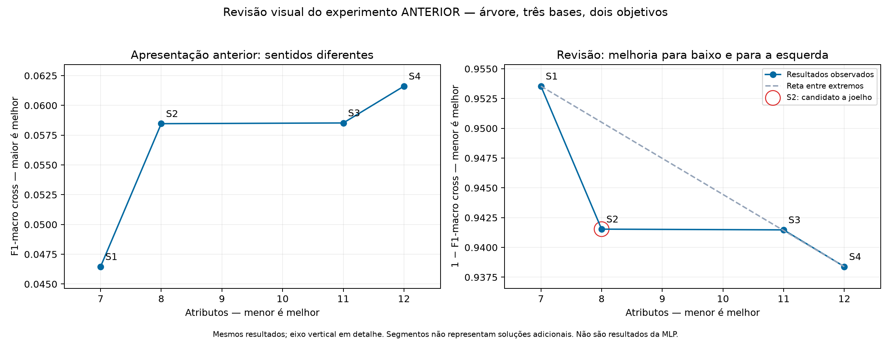

À esquerda está F1: melhorar significa subir. À direita está `1 − F1`: melhorar significa descer. A seleção e seus resultados são os mesmos; a transformação muda o sentido do eixo, sem corrigir ou alterar o algoritmo. A escala vertical detalhada realça diferenças pequenas e precisa ser mencionada.

**Candidato a joelho:** S2, com oito atributos, tem o maior desvio em direção à origem em relação à reta entre extremos, após normalizar os eixos. É uma leitura geométrica de compromisso, não prova de ótimo ou escolha automática. Código: `src/revisar_pareto_anterior.py`, função `main`, chamando `diagnosticar_curvatura` de `src/relatorio_mlp.py`.

### 8.4 F1 por direção

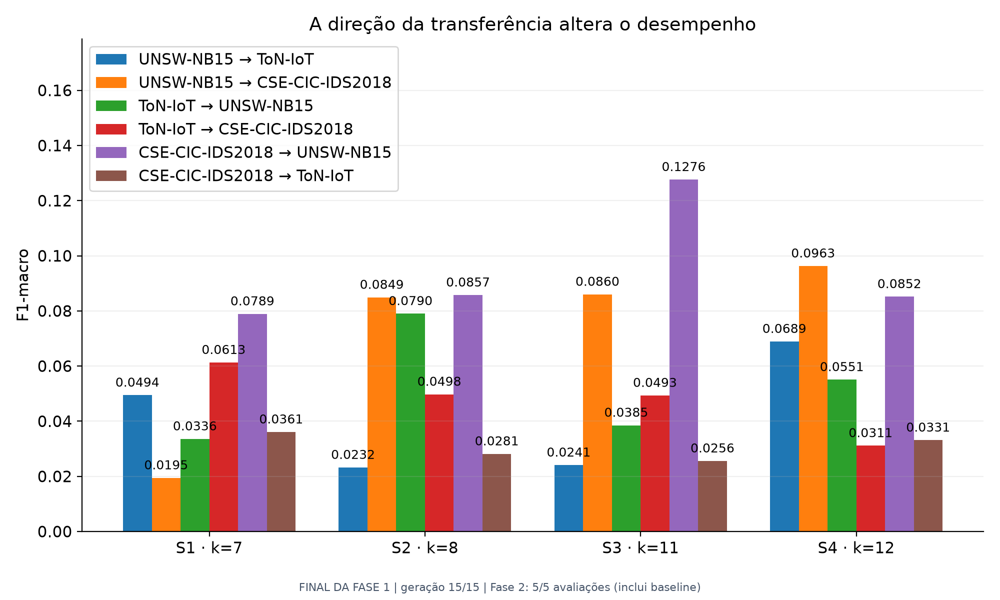

**Como ler:** cada grupo é uma solução; cada cor é uma direção origem→destino; altura = F1-macro. Use a tabela da seção 7.1 para apontar a perda de S4 em ToN→UNSW. Não confunda a cor com classe de ataque.

**Abra [src/relatorio_orientadores.py, linha 187](../src/relatorio_orientadores.py#L187).** Recorte literal das linhas 187 a 190:

```python
        for j,direcao in enumerate(dirs):
            vals=[s['f1_macro_cross_por_direcao'][direcao] for s in sols]
            bars=ax.bar(x+(j-(len(dirs)-1)/2)*largura,vals,largura,label=curto(direcao),color=plt.get_cmap('tab10')(j))
            ax.bar_label(bars,fmt='%.4f',padding=4,fontsize=9)
```

### 8.5 Partição do erro por grupos de classes

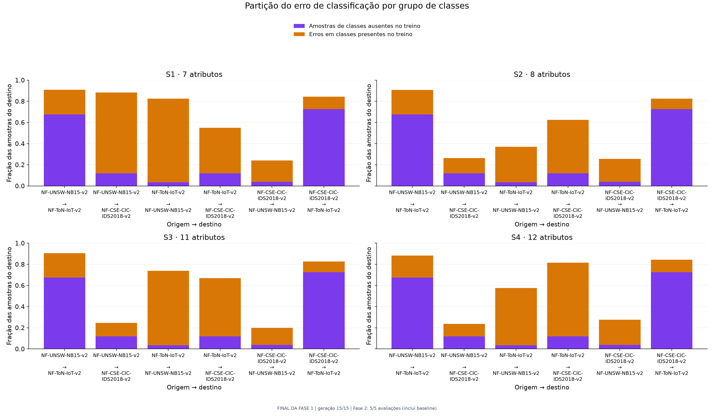

**Como ler:** um painel por solução; horizontal = transferências; vertical = fração das amostras no destino. Roxo indica exemplos de classes ausentes no treinamento da origem. Laranja indica exemplos classificados incorretamente entre as classes presentes na origem, ponderados pela fração conhecida.

**Abra [src/relatorio_orientadores.py, linha 212](../src/relatorio_orientadores.py#L212).** Recorte literal das linhas 212 a 214:

```python
                p = info['prop_desconhecidas']
                desconhecidas.append(p)
                erros.append((1-p)*(1-info['acuracia_classes_conhecidas']))
```

Se `p` é a fração desconhecida e `a` a acurácia nas conhecidas, o total empilhado é `p + (1 − p) × (1 − a)`. Isso descreve a taxa de erro por amostra nessa avaliação. **Não é uma decomposição de `1 − F1`.** O complemento até 1 representa os acertos nas classes conhecidas. Roxo não deve ser apresentado como classe “detectada como desconhecida”: o modelo não implementa rejeição de classes desconhecidas.

Existe linguagem antiga no cabeçalho de `src/graficos_cross.py` associando parcelas a causas. Para a apresentação, use a fórmula e a leitura acima: erros em classes conhecidas não isolam causalmente domain shift. O gerador atual é `src/relatorio_orientadores.py`.

### 8.6 Atributos selecionados

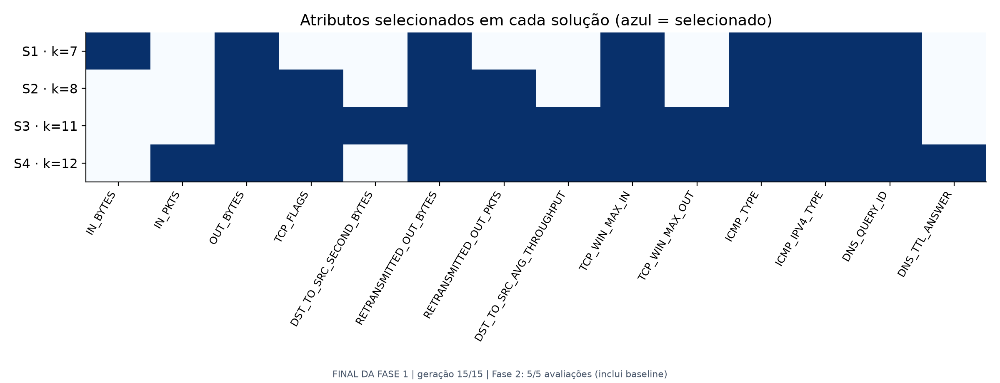

**Como ler:** linhas = soluções; colunas = atributos presentes em pelo menos uma seleção; azul = selecionado, claro = ausente. Atributos nunca selecionados não aparecem nessa figura. Frequência de seleção não é importância causal e não substitui uma análise específica de importância.

**Abra [src/relatorio_orientadores.py, linha 236](../src/relatorio_orientadores.py#L236).** Recorte literal das linhas 236 a 238:

```python
        selecao=np.array([s['mascara'] for s in sols])
        indices=np.where(selecao.any(axis=0))[0]
        ax.imshow(selecao[:,indices],cmap='Blues',vmin=0,vmax=1,aspect='auto')
```

### 8.7 Matrizes de confusão

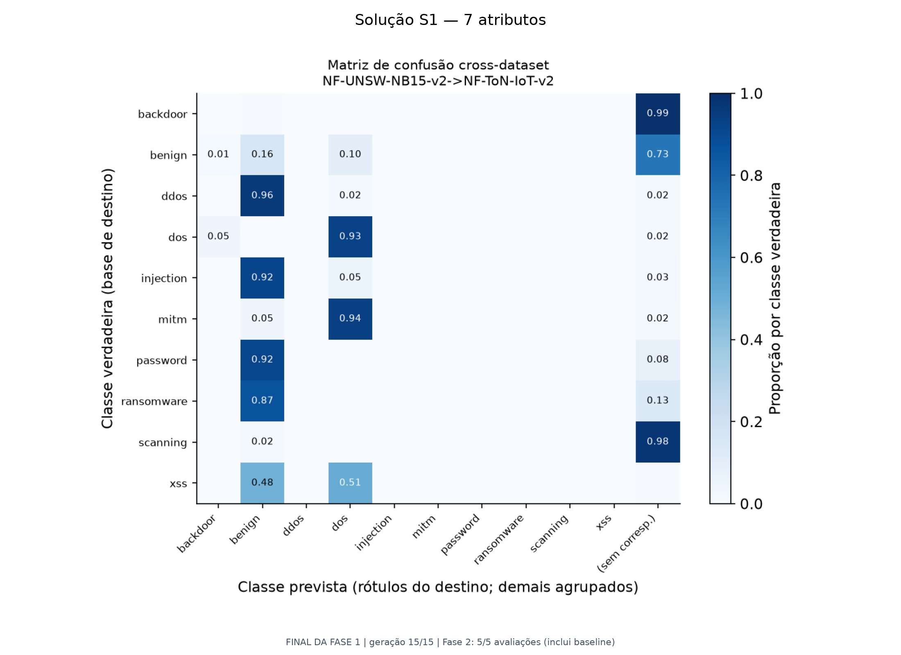

**Como ler em quatro passos:** identifique a solução no título; identifique a direção; escolha uma linha que representa uma classe verdadeira; percorra as colunas para ver as classes previstas. O valor da diagonal normalizada é o recall daquela classe. Se uma célula diagonal vale `0,80`, 80% dos exemplos daquela classe foram reconhecidos corretamente.

Nos pacotes da árvore, as matrizes são da **S1, a mais compacta**: três atributos na rodada de duas bases e sete na rodada de três. Não são da S4 ou do baseline. A coluna “sem correspondência” reúne previsões cuja classe de origem não pertence ao vocabulário do destino; isso é diferente do código `-1` atribuído ao rótulo verdadeiro desconhecido na métrica cross.

**Abra [src/relatorio_orientadores.py, linha 247](../src/relatorio_orientadores.py#L247).** Recorte literal das linhas 247 a 247:

```python
            plot_matriz_confusao(sols[0]['diagnostico_cross'],direcao,str(caminho))
```

**Abra [src/graficos_cross.py, linha 62](../src/graficos_cross.py#L62).** Recorte literal das linhas 62 a 63:

```python
    soma_linha = cm.sum(axis=1, keepdims=True)
    cm_norm = np.divide(cm, soma_linha, out=np.zeros_like(cm), where=soma_linha > 0)
```

### 8.8 Comparação intra e cross com baseline

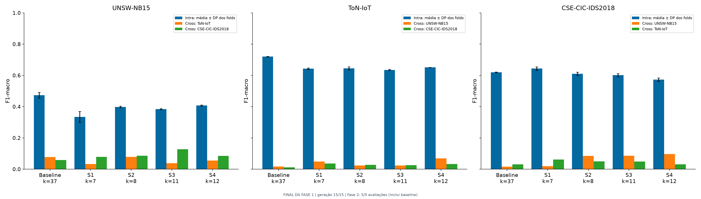

**Como ler:** cada painel fixa a base de destino. No horizontal estão baseline e soluções. Azul mostra F1 intra médio; as outras barras mostram os modelos treinados nas outras bases e avaliados no destino do painel. As hastes no azul são desvio padrão entre folds.

**Fala sugerida:**

> “No painel ToN, o baseline atinge aproximadamente 0,719982 em avaliação dentro da própria base. Isso não garante bom desempenho quando o treinamento vem de outra base. Com S4, o intra fica em 0,651292, enquanto as transferências para ToN são 0,068919 e 0,033129.”

Localize a construção desse painel em `src/relatorio_orientadores.py`, procurando `if avaliacoes:` e `salvar(fig,'06_intra_vs_cross')`. Não use médias genéricas de outros scripts para explicar esse gráfico, que é separado por destino.

## 9 Métricas que você precisa explicar sem decorar

**Precisão de uma classe:** entre os exemplos previstos como aquela classe, quantos estavam corretos. **Recall:** entre os exemplos verdadeiros daquela classe, quantos foram reconhecidos. **F1:** média harmônica entre precisão e recall. **Macro-F1:** média dos F1 das classes, dando o mesmo peso a cada classe considerada. **Acurácia:** fração de exemplos classificados corretamente, que pode ser influenciada pelas classes mais numerosas.

```text
Precisão = VP / (VP + FP)
Recall   = VP / (VP + FN)
F1       = 2 × Precisão × Recall / (Precisão + Recall)
Macro-F1 = soma dos F1 das classes / quantidade de classes consideradas
```

As divisões sem denominador positivo recebem zero conforme a implementação. Macro-F1 não torna o resultado imune a todos os efeitos do desbalanceamento ou da taxonomia.

**Atenção à palavra erro:** `1 − F1-macro = 0,45` não significa que 45% das linhas foram classificadas incorretamente. A taxa de erro por linha é `1 − acurácia`. No roteiro, “erro” nos gráficos Pareto é o nome do objetivo baseado em F1.

Na árvore cross, as desconhecidas são agrupadas no código `-1` e a métrica usa os rótulos observados e previstos. Na MLP, o macro-F1 usa o vocabulário fixo de treino, inclusive nas tabelas por origem; classes sem suporte nem previsão contribuem com zero. Essa convenção ajuda a explicar por que F1 de painéis diferentes não deve ser comparado sem examinar as classes.

**Abra [Modulos/modelo_mlp.py, linha 24](../Modulos/modelo_mlp.py#L24).** Recorte literal das linhas 24 a 31:

```python
    suporte = cm.sum(axis=1)
    previstos = cm.sum(axis=0)
    acertos = np.diag(cm)
    recall = np.divide(acertos, suporte, out=np.zeros(len(classes)), where=suporte > 0)
    precisao = np.divide(acertos, previstos, out=np.zeros(len(classes)), where=previstos > 0)
    f1 = np.divide(2*acertos, suporte+previstos, out=np.zeros(len(classes)),
                   where=(suporte+previstos) > 0)
    return dict(f1_macro=float(f1.mean()), acuracia=float(acertos.sum()/max(1, cm.sum())),
```

## 10 Protocolo da MLP e divisão dos dados

### 10.1 Novo desenho experimental

**Fala sugerida:**

> “Eu reúno os treinos das três bases em um único processo de aprendizado. O modelo vê exemplos das três origens, mas os exemplos de validação e teste ficam separados. Portanto, avalio registros reservados dessas origens, não uma quarta base desconhecida.”

A configuração está em `src/config_mlp_conjunto.yaml`. Planejei 70%/15%/15%, com agrupamento de entradas idênticas. As proporções reais são aproximadas, pois grupos inteiros podem concentrar muitas linhas.

| Partição | Registros | Percentual real |
| --- | --- | --- |
| treino | 24500089 | 72,03% |
| validacao | 4304724 | 12,66% |
| teste | 5211137 | 15,32% |

### 10.2 Por que agrupar antes de dividir

Se duas linhas com os mesmos atributos fossem divididas entre treino e teste, a avaliação poderia ficar facilitada pela repetição da entrada. O código calcula um hash dos **37 atributos comuns em `float32`, antes da seleção**, sem usar origem ou rótulo, e associa o grupo inteiro a uma partição. Assim, a regra é comum às três bases e às máscaras.

**Abra [Modulos/dados_mlp.py, linha 33](../Modulos/dados_mlp.py#L33).** Recorte literal das linhas 33 a 42:

```python
    grupos = pd.util.hash_pandas_object(pd.DataFrame(X), index=False).to_numpy()
    # Eu misturo os bits com uma semente fixa sem depender da ordem de leitura.
    with np.errstate(over='ignore'):
        h = grupos ^ np.uint64(seed)
        h = (h ^ (h >> np.uint64(30))) * np.uint64(0xbf58476d1ce4e5b9)
        h = (h ^ (h >> np.uint64(27))) * np.uint64(0x94d049bb133111eb)
        h ^= h >> np.uint64(31)
    u = (h >> np.uint64(11)).astype(np.float64) / (2 ** 53)
    partes = np.searchsorted(np.cumsum(fracoes)[:2], u, side='right')
    return grupos, partes
```

**Explique:** a primeira linha identifica grupos por atributos; a seed mistura os bits de maneira determinística; `u` fornece um valor usado com os limites cumulativos das frações; `np.searchsorted` escolhe treino, validação ou teste. Duplicatas são preservadas dentro da mesma partição. Isso não é deduplicação.

Esse agrupamento não garante independência temporal ou de sessões, não elimina quase duplicatas e não faz estratificação exata. As contagens por classe e origem ficam no manifesto. O código interrompe a preparação se alguma classe não tiver exemplos de treino.

### 10.3 Padronização ajustada somente no treino

**Abra [Modulos/dados_mlp.py, linha 118](../Modulos/dados_mlp.py#L118).** Recorte literal das linhas 118 a 119:

```python
                if parte == 'treino':
                    scaler.partial_fit(X[selecao])
```

**Abra [Modulos/dados_mlp.py, linha 159](../Modulos/dados_mlp.py#L159).** Recorte literal das linhas 159 a 165:

```python
    def transformar(self, X, indices):
        selecionado = np.array(X[:, indices], dtype='float32', copy=True)
        selecionado -= self.media[indices]
        selecionado /= self.escala[indices]
        if not np.isfinite(selecionado).all():
            raise ValueError('Transformação produziu valores não finitos.')
        return selecionado
```

**Explique:** para cada atributo, subtrai a média do treino e divide pelo desvio estimado no treino. A mesma transformação é aplicada às outras partições. Nunca calcula uma nova média na validação ou no teste. `partial_fit` do scaler acumula estatísticas por lotes; não significa ajustar uma normalização diferente para cada lote.

Arquivos binários e `np.memmap` permitem acessar matrizes grandes em disco. O processamento em lotes e o limite de duas threads controlam recursos; não diminuem o número de exemplos usado no cálculo de F1.

## 11 Treinamento da MLP e baseline

### 11.1 Arquitetura

**Abra [Modulos/modelo_mlp.py, linha 76](../Modulos/modelo_mlp.py#L76).** Recorte literal das linhas 76 a 80:

```python
        modelo = MLPClassifier(hidden_layer_sizes=(2*len(indices),)*3,
                               activation=cfg['ativacao'], solver='adam',
                               learning_rate_init=cfg['taxa_aprendizado'], alpha=cfg['alpha'],
                               batch_size=cfg['batch_size'], random_state=config['seed'],
                               shuffle=False, early_stopping=False, max_iter=1)
```

`k` entradas → três camadas ocultas com `2k` neurônios cada → classes de saída. ReLU é a ativação das camadas ocultas. Adam ajusta os pesos; taxa inicial 0,001 e regularização `alpha=0,0001` constam da configuração. O minibatch do treinamento tem tamanho 1.024. O lote externo de leitura tem 65.536 registros: são parâmetros distintos.

| Seleção | Entradas | Camadas ocultas |
| --- | --- | --- |
| Baseline | 37 | 74, 74, 74 |
| Exemplo S16 do relatório parcial | 17 | 34, 34, 34 |
| Exemplo S12 do relatório parcial | 11 | 22, 22, 22 |

**Consequência para discutir:** reduzir atributos também reduz a arquitetura. Um ganho de tempo não pode ser atribuído exclusivamente à seleção de colunas.

### 11.2 Desbalanceamento e épocas

**Abra [Modulos/modelo_mlp.py, linha 71](../Modulos/modelo_mlp.py#L71).** Recorte literal das linhas 71 a 72:

```python
    contagens = np.bincount(treino['y'], minlength=len(classes))
    pesos = n / (len(classes) * contagens)
```

O peso de cada classe é inversamente proporcional à sua frequência no treino. Esses pesos são passados como pesos dos exemplos em `partial_fit`. Não há subamostragem para balancear as classes.

**Abra [Modulos/modelo_mlp.py, linha 83](../Modulos/modelo_mlp.py#L83).** Recorte literal das linhas 83 a 94:

```python
    while estado['epoca'] < cfg['epocas_maximas'] and estado['sem_melhora'] < cfg['paciencia']:
        inicio = time.perf_counter()
        epoca = estado['epoca'] + 1
        rng = np.random.default_rng(config['seed'] + epoca)
        ordem = rng.permutation(n)
        modelo = estado['modelo']
        for pos in range(0, n, config['recursos']['lote_dados']):
            sel = ordem[pos:pos+config['recursos']['lote_dados']]
            X = dados.transformar(treino['X'][sel], indices)
            y = treino['y'][sel]
            modelo.partial_fit(X, y, classes=classes,
                              sample_weight=pesos[y] if cfg['pesos_balanceados'] else None)
```

`sample_weight` recebe `pesos[y]` quando o balanceamento está habilitado. A cada época, os índices de **todo o treino conjunto** são embaralhados e percorridos em lotes. `shuffle=False` na MLP não significa ausência de embaralhamento: o laço externo faz isso explicitamente.

Uma **época** é uma passagem pelos exemplos de treino de uma MLP. Uma **geração** é uma etapa da população do NSGA-II, que pode exigir treinar várias MLPs. Cem gerações não são cem épocas de uma rede única.

### 11.3 Parada e melhor modelo

**Abra [Modulos/modelo_mlp.py, linha 99](../Modulos/modelo_mlp.py#L99).** Recorte literal das linhas 99 a 104:

```python
        if f1 > estado['melhor_f1'] + cfg['min_delta']:
            estado.update(melhor_modelo=copy.deepcopy(modelo), melhor_f1=f1,
                          melhor_epoca=epoca, sem_melhora=0)
        else:
            estado['sem_melhora'] += 1
        estado['epoca'] = epoca
```

Limite de 30 épocas, paciência de cinco e melhora mínima de 0,0001 no F1 de validação. `copy.deepcopy` preserva uma cópia do melhor modelo. O `early_stopping=False` da biblioteca evita uma divisão automática adicional: o código controla a parada com a validação já preparada. `max_iter=1` não significa treinar uma única época no experimento, pois o treinamento incremental é repetido pelo laço externo.

O baseline real executou **11 épocas**, preservando o modelo da **época 6**, conforme `baseline_validacao.json`. Esse comportamento é compatível com cinco épocas posteriores sem melhora suficiente.

### 11.4 Origem do baseline da MLP

**Abra [Modulos/busca_mlp.py, linha 77](../Modulos/busca_mlp.py#L77).** Recorte literal das linhas 77 a 77:

```python
    baseline = avaliador.obter(np.ones(d, dtype=int))
```

**Resposta pronta:**

> “O baseline da MLP é treinado pelo mesmo avaliador das outras máscaras, com todos os 37 atributos. Isso gera três camadas ocultas de 74 neurônios. Ele usa os mesmos dados e regras de treinamento. Seu F1 de validação é 0,515587 e seu tempo mediano observado é 1,631229 microssegundo por evento em lote.”

É calculado antes da busca, incluído na população inicial e usado para fixar a referência de tempo do hipervolume. O código reutiliza modelos e métricas já salvos para a mesma identidade experimental.

## 12 Medição do terceiro objetivo e avaliação final planejada

### 12.1 Como o tempo é medido

Configuração: até 65.536 eventos da validação, escolhidos com seed 42 e repetidos entre máscaras; lotes de 4.096; dois aquecimentos; sete repetições; duas threads. O F1 usa toda a validação, não apenas esses eventos de benchmark.

**Abra [Modulos/modelo_mlp.py, linha 129](../Modulos/modelo_mlp.py#L129).** Recorte literal das linhas 129 a 144:

```python
    def prever():
        for inicio in range(0, n, cfg['lote']):
            modelo.predict(dados.transformar(X[inicio:inicio+cfg['lote']], indices))
    for _ in range(cfg['aquecimentos']):
        prever()
    totais = []
    for _ in range(cfg['repeticoes']):
        inicio = time.perf_counter_ns()
        prever()
        totais.append((time.perf_counter_ns()-inicio)/1e9)
    por_evento = np.array(totais)/n
    return dict(eventos=n, lote=cfg['lote'], repeticoes=cfg['repeticoes'],
                segundos_totais=totais, segundos_por_evento=por_evento.tolist(),
                mediana_s=float(np.median(por_evento)), maximo_observado_s=float(por_evento.max()),
                minimo_s=float(por_evento.min()), desvio_s=float(por_evento.std()),
                escopo='padronização dos atributos selecionados + predict; sem leitura de disco')
```

**Explique na ordem:** carrega previamente os eventos; aquece a execução; cronometra o laço de padronização e previsão; divide o tempo total pela quantidade de eventos; calcula a mediana e o maior valor das sete médias por evento. Inclui a sobrecarga do laço medido; exclui carregamento inicial do disco e treinamento.

**Unidades:** `1 µs = 0,000001 segundo`. O valor por evento resulta do processamento em lotes. Não representa necessariamente a latência de uma requisição individual. “Máximo observado” é o maior tempo médio por evento entre repetições, não um limite universal de pior caso.

**Fala sugerida:**

> “Uso a mediana para reduzir a influência de uma repetição excepcionalmente lenta. Também guardo o máximo observado, mas não o apresento como maior latência possível. Os valores dependem da máquina e da carga de execução.”

O tempo da árvore cronometra `predict` no cross e depois calcula média entre direções. O da MLP inclui padronização, repetições e uma amostra fixa de validação. Comparar esses números diretamente não é um benchmark controlado entre arquiteturas.

### 12.2 Como as escolhas serão fixadas antes do teste

**Abra [Modulos/busca_mlp.py, linha 128](../Modulos/busca_mlp.py#L128).** Recorte literal das linhas 128 a 130:

```python
    escolhas = {'maior_f1': int(np.argmin(F[:, 0])), 'mais_compacta': int(np.argmin(F[:, 1])),
                'mais_rapida': int(np.argmin(F[:, 2])),
                'compromisso': int(np.argmin(np.linalg.norm(normal, axis=1)))}
```

Escolhe representantes de maior F1, menor quantidade, menor tempo e compromisso. O compromisso usa a menor distância à origem nos três objetivos com tempo transformado, atribuindo pesos iguais nessa escala. Adiciona baseline e remove máscaras repetidas. Essa regra pode escolher solução diferente do joelho geométrico em dois eixos.

**Abra [Modulos/busca_mlp.py, linha 148](../Modulos/busca_mlp.py#L148).** Recorte literal das linhas 148 a 155:

```python
    escolhas_path = pasta/'escolhas_antes_do_teste.json'
    escolhas = escolher_solucoes(estado)
    if escolhas_path.exists():
        if json.loads(escolhas_path.read_text()) != escolhas:
            raise ValueError('Escolhas de validação divergiram; eu não seleciono pelo teste.')
    else:
        salvar_json(escolhas_path, escolhas)
    resultados = []
```

Grava `escolhas_antes_do_teste.json` antes de avaliar as escolhas no teste. O modelo salvo é reutilizado, sem retreinar com o teste. No estado disponível, essa etapa ainda não tem resultado final salvo. A validação já orienta treinamento, parada e seleção; seus ganhos precisam ser confirmados no teste reservado, sem escolher a vencedora olhando o teste.

## 13 Resultados parciais da MLP

Fonte da geração: `Resultados/mlp_conjunto_v1/geracoes/053.json`. Fonte da tabela: `Resultados/mlp_conjunto_v1/figuras/resumo_validacao.csv`. Todos os F1 abaixo são **de validação**, não de teste. A frente contém 17 máscaras distintas nessa geração. Os identificadores S1, S2 etc. são rótulos da frente atual e podem mudar entre gerações; a máscara é a identidade da seleção.

| Solução | Atributos | F1 de validação | Mediana em µs/evento | Máximo observado em µs/evento |
| --- | --- | --- | --- | --- |
| S1 | 2 | 0,101787 | 0,945942 | 0,967730 |
| S2 | 4 | 0,317251 | 0,707915 | 0,751168 |
| S3 | 4 | 0,222187 | 0,656656 | 0,689196 |
| S4 | 4 | 0,326146 | 0,725767 | 0,800517 |
| S5 | 5 | 0,369025 | 0,749354 | 0,801001 |
| S6 | 5 | 0,268016 | 0,680444 | 0,716525 |
| S7 | 6 | 0,419866 | 1,124837 | 1,277063 |
| S8 | 7 | 0,456258 | 1,401376 | 1,507114 |
| S9 | 8 | 0,466015 | 0,788879 | 0,871970 |
| S10 | 9 | 0,468183 | 1,095867 | 1,398944 |
| S11 | 9 | 0,482780 | 1,534952 | 1,727770 |
| S12 | 11 | 0,509080 | 1,028849 | 1,250455 |
| S13 | 12 | 0,501847 | 1,003117 | 1,061392 |
| S14 | 13 | 0,492505 | 0,908032 | 0,929379 |
| S15 | 14 | 0,526748 | 1,208757 | 1,383041 |
| S16 | 17 | 0,544031 | 1,028203 | 1,159316 |
| S17 | 21 | 0,551061 | 1,316958 | 1,462524 |
| Baseline | 37 | 0,515587 | 1,631229 | 1,756120 |

### 13.1 Exemplos para explicar em voz alta

**S12:** 11 atributos, F1 0,509080 e tempo 1,028849 µs/evento. Fica próximo do F1 do baseline, usando 70,27% menos atributos e aproximadamente 36,93% menos tempo mediano nessa medição. A diferença de F1 é de aproximadamente −0,006508; “próximo” é descritivo, não um teste de equivalência.

**S16:** 17 atributos, F1 0,544031 e tempo 1,028203 µs/evento. Apresenta melhora numérica de F1 de aproximadamente +0,028444, redução de atributos de 54,05% e de tempo mediano de aproximadamente 36,97% em relação ao baseline.

**S17:** 21 atributos e maior F1 da frente mostrada, 0,551061. Seu tempo mediano é 1,316958 µs/evento: maior que o de S16, embora menor que o do baseline. Isso exemplifica por que o maior F1 não encerra a decisão multiobjetivo.

**S3:** quatro atributos e menor tempo mediano da tabela, aproximadamente 0,656656 µs/evento; o F1 é somente 0,222187. Ser rápida não a torna automaticamente a escolha desejada.

**Fala sugerida:**

> “Na geração 53, algumas soluções apresentam menos atributos, maior F1 de validação e menor tempo mediano que o baseline. A S16 exemplifica esse resultado. É uma evidência parcial favorável dentro desta execução; preciso concluir a busca, fixar escolhas e avaliar o teste para sustentar a conclusão final.”

Nos três objetivos observados, S16 domina o baseline. Isso não garante significância estatística, estabilidade entre seeds ou superioridade em teste. Também não torna S16 a única opção: S17 oferece F1 maior com custo maior.

## 14 Como explicar os gráficos da MLP

**Atualização de 23/10/2026:** eu mudei a codificação das figuras 01 e 02 (Entrada 005 do [diário](diario_de_pesquisa.md)). As figuras abaixo apontam para os arquivos vivos da execução; a cópia da nova codificação na geração 72 está em `Resultados/revisao_pareto_tres_objetivos/`. Os exemplos numéricos desta seção continuam referindo-se à geração 53, e os rótulos S* são renumerados a cada geração, então confira os valores na tabela da geração exibida no rodapé.

### 14.1 Pareto erro e atributos com tempo na cor

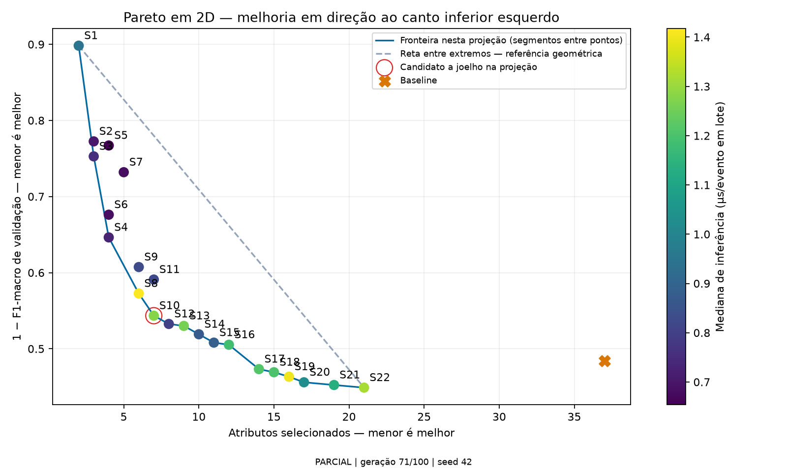

**Sequência de leitura:**

1. Leia o título, “Erro × atributos — cor: tempo”, e o rodapé: situação, geração e seed 42.
2. Horizontal: número de atributos; menor é melhor.
3. Vertical: `1 − F1-macro de validação`; menor é melhor.
4. Cor: tempo mediano em µs/evento em lote, em azul; mais escuro é mais lento, portanto pior. A barra de cores nomeia o objetivo, e a legenda traz dois quadrados com o tom claro e o escuro e o tempo correspondente a cada extremo.
5. Círculo: solução na fronteira desta projeção. Losango: fora da fronteira projetada, mas não dominada nos três objetivos, porque é mais rápida que quem a domina aqui.
6. X cinza: baseline com 37 atributos.
7. Linha escura: pontos não dominados **na projeção de dois objetivos**.
8. Reta tracejada: referência geométrica entre os extremos.
9. Círculo vermelho: candidato geométrico a joelho (S8 na geração 53).

**Abra [src/relatorio_mlp.py, linha 18](../src/relatorio_mlp.py#L18).** Recorte literal das linhas 18 a 21:

```python
# Eu dou uma única matiz a cada objetivo, nas três figuras; mais escuro é sempre pior.
OBJETIVOS = dict(atributos=('Atributos selecionados', 'Greens', 'atributos = {:.0f}'),
                 erro=('1 − F1-macro de validação', 'Purples', 'erro 1 − F1 = {:.3f}'),
                 tempo=('Mediana de inferência (µs/evento em lote)', 'Blues', 'tempo = {:.2f} µs/evento'))
```

**Abra [src/relatorio_mlp.py, linha 29](../src/relatorio_mlp.py#L29).** Recorte literal das linhas 29 a 62; esta função desenha as três projeções com a mesma codificação:

```python
def painel_pareto(fig, ax, valores, eixo_x, eixo_y, objetivo_cor, livre, sols, base):
    """Eu desenho uma projeção com a mesma codificação em todas as figuras."""
    xx, yy, cor = valores[eixo_x], valores[eixo_y], valores[objetivo_cor]
    ind = fronteira_2d(xx, yy)
    na_projecao = np.isin(np.arange(len(sols)), ind)
    mapa = mapa_objetivo(objetivo_cor)
    # Eu nomeio na legenda o objetivo da cor e o valor dos tons extremos.
    for fracao, tom, sentido, valor in [(0., 'clara', 'melhor', cor.min()), (1., 'escura', 'pior', cor.max())]:
        ax.scatter([], [], marker='s', s=70, color=mapa(fracao), edgecolors='#334155', linewidths=.7,
                   label=f'Cor {tom}: {OBJETIVOS[objetivo_cor][2].format(valor)} ({sentido})')
    def pontos(mascara, **estilo):
        return ax.scatter(xx[mascara], yy[mascara], c=cor[mascara], cmap=mapa,
                          vmin=cor.min(), vmax=cor.max(), edgecolors='#334155', linewidths=.7,
                          zorder=3, **estilo)
    sc = pontos(na_projecao, marker='o', s=70)
    pontos(~na_projecao & livre, marker='D', s=55)
    dominadas = ~na_projecao & ~livre
    if dominadas.any():
        ax.scatter(xx[dominadas], yy[dominadas], marker='x', s=60, c='#64748b', zorder=3,
                   label='Dominada nos três objetivos')
    ax.scatter([], [], marker='o', s=70, c='#cbd5e1', edgecolors='#334155', linewidths=.7,
               label='Na fronteira desta projeção')
    ax.scatter([], [], marker='D', s=55, c='#cbd5e1', edgecolors='#334155', linewidths=.7,
               label='Fora da fronteira 2D, não dominada nos 3 objetivos\n(compensa no objetivo da cor)')
    ax.plot(xx[ind], yy[ind], color='#334155', lw=1.2, zorder=2,
            label='Fronteira nesta projeção (segmentos entre pontos)')
    for s, xi, yi in zip(sols, xx, yy):
        ax.annotate(s['id'], (xi, yi), xytext=(5, 6), textcoords='offset points', fontsize=8)
    ax.scatter([base[eixo_x]], [base[eixo_y]], marker='X', s=100, c='#52514e', zorder=3, label='Baseline')
    fig.colorbar(sc, ax=ax, label=f'Cor = {OBJETIVOS[objetivo_cor][0]}\nmais escuro = pior')
    ax.set(xlabel=f'{OBJETIVOS[eixo_x][0]} — menor é melhor', ylabel=f'{OBJETIVOS[eixo_y][0]} — menor é melhor',
           title=f'{eixo_y.capitalize()} × {eixo_x} — cor: {objetivo_cor}')
    ax.grid(alpha=.2)
    return ind
```

**Abra [src/relatorio_mlp.py, linha 132](../src/relatorio_mlp.py#L132).** Recorte literal da linha 132; a figura principal passa atributos e erro nos eixos e tempo na cor:

```python
        ind = painel_pareto(fig, ax, valores, 'atributos', 'erro', 'tempo', livre, sols, base_valores)
```

**Exemplo de leitura (geração 53):** S16 tem `1 − 0,544031 ≈ 0,455969` no vertical; o baseline tem `1 − 0,515587 ≈ 0,484413`. S16 aparece mais à esquerda e mais abaixo, com menor tempo mediano que o baseline na tabela.

S8 tem sete atributos, F1 aproximadamente 0,456258 e tempo 1,401376 µs/evento. Ela é destacada pelo formato geométrico em dois eixos, mas S16 tem F1 maior e tempo menor com mais atributos. O círculo não significa “melhor modelo”, e não considera o tempo ao calcular esse joelho.

### 14.2 Por que aparecem pontos acima da linha da fronteira

**Abra [src/relatorio_mlp.py, linha 65](../src/relatorio_mlp.py#L65).** Recorte literal das linhas 65 a 80:

```python
def fronteira_2d(x, y):
    """Índices não dominados na projeção de dois objetivos minimizados."""
    x, y = np.asarray(x), np.asarray(y)
    indices = []
    melhor = float('inf')
    for i in sorted(range(len(x)), key=lambda i: (x[i], y[i])):
        if y[i] < melhor:
            indices.append(i)
            melhor = y[i]
    return indices


def nao_dominados(F):
    """Máscara das linhas de F não dominadas em todos os objetivos minimizados."""
    F = np.asarray(F, dtype=float)
    return np.array([not ((F <= f).all(axis=1) & (F < f).any(axis=1)).any() for f in F], dtype=bool)
```

O conjunto foi otimizado em três objetivos. Ao desenhar apenas atributos e erro, um ponto pode parecer dominado, mas continuar relevante por ser mais rápido. Por exemplo, na geração 53, S3 tinha F1 pior que S4 com os mesmos quatro atributos, porém era mais rápida. `fronteira_2d` liga apenas os pontos não dominados na projeção; `nao_dominados` confere a dominância nos três objetivos e define quem vira losango. Na geração 72, S11 e S18 ficam fora das três fronteiras projetadas e continuam não dominadas, porque equilibram os três objetivos.

### 14.3 Diagnóstico de curvatura

**Abra [src/relatorio_mlp.py, linha 93](../src/relatorio_mlp.py#L93).** Recorte literal das linhas 93 a 95:

```python
    normal = (pontos-pontos.min(axis=0))/amplitude
    ganhos = (1-normal.sum(axis=1))/np.sqrt(2)
    i = int(np.argmax(ganhos))
```

Os eixos são normalizados pelos extremos, e o algoritmo mede o desvio em direção à origem relativamente à reta entre extremos. Com menos de três pontos, não avalia curvatura. Esse procedimento não força uma “barriga”, não suaviza resultados e não é um teste estatístico. Na geração 53, o desvio registrado da MLP era aproximadamente 0,371817, e não uma métrica de classificação.

### 14.4 Projeções envolvendo tempo

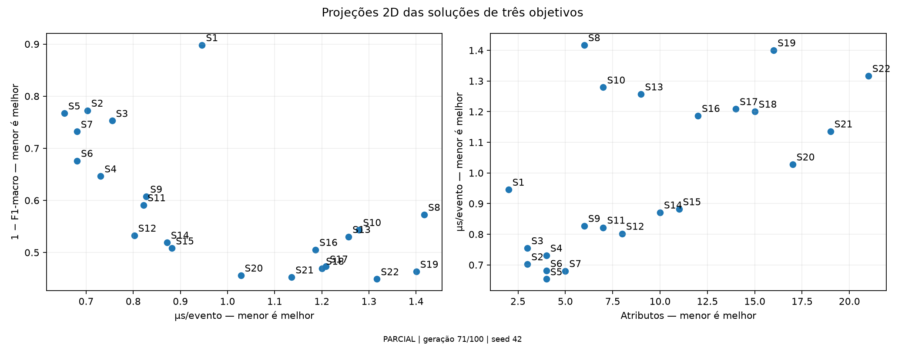

**Painel esquerdo (“Erro × tempo — cor: atributos”):** horizontal = tempo; vertical = `1 − F1`; cor = atributos, em verde. **Painel direito (“Tempo × atributos — cor: erro”):** horizontal = atributos; vertical = tempo; cor = erro, em roxo. Nos dois, melhorar significa esquerda e baixo, e mais escuro é pior. A legenda, abaixo de cada painel para não cobrir pontos, mostra o tom claro e o escuro com o número de atributos ou o erro de cada extremo. Círculos, losangos, linha da fronteira e baseline seguem a mesma regra da figura principal.

A figura fica separada da principal porque juntar as três projeções deixaria painéis pequenos para os rótulos e para o joelho. No painel direito, poucas soluções formam a fronteira (S1, S2 e S5 na geração 72), e a dispersão mostra que o tempo não cresce de maneira perfeitamente monotônica com a quantidade de atributos.

**Abra [src/relatorio_mlp.py, linha 144](../src/relatorio_mlp.py#L144).** Recorte literal das linhas 144 a 145:

```python
        painel_pareto(fig, axes[0], valores, 'tempo', 'erro', 'atributos', livre, sols, base_valores)
        painel_pareto(fig, axes[1], valores, 'atributos', 'tempo', 'erro', livre, sols, base_valores)
```

As figuras mostram as mesmas soluções em eixos diferentes; não são três experimentos separados. Desde 23/10/2026, os dois painéis também desenham o baseline.

### 14.5 Hipervolume de três objetivos

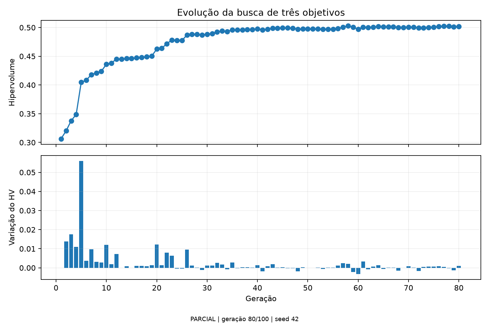

O hipervolume vai de **0,3064491432**, na geração 1, para **0,4969402744**, na geração 53. Há ganhos maiores no começo e pequenas oscilações perto de 0,50 nas últimas gerações mostradas. Isso indica ganhos recentes menores nesse indicador; não prova convergência nem ótimo global.

**Abra [Modulos/busca_mlp.py, linha 17](../Modulos/busca_mlp.py#L17).** Recorte literal das linhas 17 a 23:

```python
def normalizar_hv(F, referencia_tempo):
    """Escala fixa, monotônica e limitada; nenhum tempo é cortado."""
    F = np.array(F, dtype=float, copy=True)
    if referencia_tempo <= 0:
        raise ValueError('Referência de tempo precisa ser positiva.')
    F[:, 2] = F[:, 2] / (F[:, 2] + referencia_tempo)
    return F
```

**Abra [Modulos/busca_mlp.py, linha 97](../Modulos/busca_mlp.py#L97).** Recorte literal das linhas 97 a 99:

```python
        h = dict(geracao=int(alg.n_gen), avaliacoes=int(alg.evaluator.n_eval),
                 hipervolume=float(HV(ref_point=np.array([1.1]*3))(normalizar_hv(F, ref_tempo))),
                 solucoes=sols)
```

O terceiro eixo do HV usa `t / (t + t_ref)`, com `t_ref` fixado na mediana do baseline: aproximadamente `1,63122935 × 10⁻⁶ s/evento`. Isso mantém a transformação monotônica e abaixo de 1. A referência do HV é `[1.1, 1.1, 1.1]`. O NSGA-II continua recebendo o tempo em segundos/evento; a transformação serve ao HV e à regra de compromisso final.

**Fala sugerida:**

> “Calculo o hipervolume nos três objetivos, mesmo apresentando o Pareto em projeções 2D. O valor próximo de 0,50 não significa 50% de acurácia. Também não comparo esse número diretamente ao hipervolume de dois objetivos da árvore.”

### 14.6 Gráficos que existem no código, mas ainda não são resultados finais

`src/relatorio_mlp.py` tem um bloco `avaliacoes = estado.get('teste', [])`. Somente quando há avaliação de teste ele gera `04_validacao_teste` e matrizes `05_matriz_<solução>_<origem>`, além de CSVs por classe.

**Como serão lidos:** validação versus teste compara a métrica que orientou as escolhas com a métrica reservada; matrizes mostram contagens e percentuais por classe verdadeira; diagonal percentual é recall; traço indica ausência de exemplos da classe. Esses gráficos de teste não estão no pacote parcial conferido e não devem ser apresentados como já executados.

## 15 Como demonstrar o fluxo completo no código

### 15.1 Fluxo da árvore

Abra `src/executar_experimento.py`, função `main`, para a rodada de três bases:

```text
Configuração → identidade experimental → preparação dos dados
→ busca de 15 gerações → Pareto salvo
→ avaliações detalhadas de cada máscara e baseline
→ gráficos e marcação de conclusão
```

A rodada de duas bases também tem a continuação em `src/continuar_analise.py`. A busca usa `src/algoritmo1_otimizacao.py` e a avaliação detalhada usa `src/algoritmo2_avaliacao.py`.

**Abra [src/executar_experimento.py, linha 53](../src/executar_experimento.py#L53).** Recorte literal das linhas 53 a 54:

```python
    tarefas=[(f'avaliacao_solucao_{i:02d}.json',['--pareto',pareto,'--solucao',i],m) for i,m in enumerate(dados['mascaras'])]
    tarefas.append(('avaliacao_baseline.json',['--mascara','cheia'],[1]*len(dados['atributos'])))
```

**Explique:** monta uma tarefa por solução do Pareto e outra com máscara cheia. A identidade e a máscara são verificadas antes de reutilizar uma avaliação existente. O roteiro usa arquivos salvos, sem executar novamente os treinamentos.

### 15.2 Fluxo da MLP

**Abra [src/executar_experimento_mlp.py, linha 78](../src/executar_experimento_mlp.py#L78).** Recorte literal das linhas 78 a 82:

```python
            estado = executar_busca(avaliador, config, pasta,
                                    ao_registrar=lambda e: gerar(e, pasta/'figuras', dados.meta))
            gerar(estado, pasta/'figuras', dados.meta)
            if etapa == 'busca':
                return estado
```

**Explique:** a busca chama o gerador após registrar gerações; se a etapa solicitada for apenas `busca`, retorna antes do teste; no fluxo completo, fixa as escolhas, avalia o teste, salva `resultado_final.json` e cria `analise.concluida.json`. A existência de um PNG não comprova que o fluxo chegou ao fim.

### 15.3 Rastreabilidade e retomada

`Modulos/checkpoint.py` mantém cache e progresso da árvore. Na MLP, cada máscara tem diretório de modelo e critérios; o treino incremental salva estado da rede e do otimizador por época. Uma interrupção no meio de uma época exige refazer aquela época a partir do estado salvo anterior.

`src/executar_experimento_mlp.py` registra configuração, hashes de código, identidade dos dados, versões e ambiente no `experimento.json`. Isso protege contra misturar resultados de protocolos diferentes; não demonstra sozinho reprodutibilidade em qualquer máquina. `src/relatorio_mlp.py` usa a seed 42 escrita no rodapé: ela corresponde à configuração atual, mas, se a seed mudar no futuro, o gerador também precisará refletir a nova seed.

## 16 Perguntas prováveis e respostas seguras

**De onde veio o baseline?**

“Foi calculado no próprio experimento usando todos os 37 atributos candidatos. Na árvore, usa a mesma árvore e as mesmas avaliações; na MLP, usa a mesma regra de treinamento com três camadas de 74 neurônios.”

**Por que 37 atributos se a base tem mais colunas?**

“São os atributos numéricos comuns restantes após excluir os rótulos e as colunas definidas como possíveis atalhos. Eu salvo a lista e a ordem, em vez de assumir que todas as colunas brutas podem entrar no modelo.”

**O terceiro dataset é teste externo?**

“Na rodada de árvore com três bases, ele participa da seleção e das seis transferências. Na MLP, participa do treino conjunto. Em nenhuma dessas situações ele é uma base externa completamente reservada.”

**A MLP é melhor que a árvore?**

“Os protocolos mudaram. A árvore avalia transferência e a MLP aprende com as três origens. Posso comparar as soluções com o baseline de cada protocolo, mas preciso de um experimento controlado para atribuir a diferença à arquitetura.”

**Menos atributos sempre significa mais rapidez?**

“Não. Eu meço o tempo como objetivo porque a relação não é garantida. Na MLP também mudo o tamanho das camadas ao mudar a quantidade de atributos.”

**Por que o baseline não está na fronteira?**

“Usar todos os atributos não garante o melhor resultado. Uma seleção pode dominar o baseline. Na MLP parcial, S16 é numericamente melhor nos três objetivos. No gráfico original da árvore, o baseline não recebe um marcador explícito; uso as tabelas e a figura intra/cross para compará-lo.”

**Por que existe uma solução acima da linha do Pareto da MLP?**

“A linha representa a fronteira projetada em dois objetivos. O conjunto foi selecionado em três; o tempo pode tornar relevante uma solução que parece pior apenas nos outros dois.”

**Por que não mostrar o Pareto em 3D?**

“Num 3D impresso, a perspectiva impede ler valores e os rótulos se sobrepõem; desenhar uma superfície exigiria inventar pontos entre as soluções. Eu mostro três projeções 2D com a mesma codificação: a cor é o objetivo fora dos eixos e o losango indica que a solução não é dominada nos três. Para ver os três objetivos ao mesmo tempo, eu uso as coordenadas paralelas.”

**Por que o Pareto de erro e o de tempo estão em figuras separadas?**

“A figura principal, erro versus atributos, concentra o trade-off central e o diagnóstico de joelho e precisa de espaço para os rótulos. As duas projeções com tempo ficam juntas em outra figura, com as mesmas regras de cor, formato e baseline, então as três podem ser comparadas diretamente.”

**A forma da curva prova que o NSGA-II funcionou?**

“O formato visual depende dos eixos e dos pontos encontrados. A mudança de F1 para um menos F1 inverte o sentido vertical. Examino os objetivos, a dominância e a trajetória; a forma sozinha não prova ótimo ou convergência.”

**O joelho é a solução final?**

“Ele é uma indicação geométrica em uma projeção. A escolha de compromisso da MLP usa outra regra, com os três objetivos, antes de abrir o teste.”

**Cem gerações garantem convergência?**

“Não. Esse é o orçamento de busca configurado. Preciso avaliar trajetória, outras seeds e estabilidade. Os arquivos disponíveis da MLP ainda estão na geração 53.”

**Qual é a interpretação do F1 baixo na árvore?**

“A transferência é difícil neste desenho, com diferenças nas bases e nas classes. A seleção melhora algumas métricas relativas ao baseline, mas os valores absolutos são baixos. Minha análise não permite atribuir toda a perda a uma única causa.”

**O conjunto de validação é independente da busca?**

“Na MLP, ele é usado repetidamente para parada e avaliação das máscaras. O teste reservado é a etapa para verificar as escolhas depois de fixadas. Na árvore, as bases de transferência participam diretamente da seleção, então os números cross não são um teste externo independente do processo completo.”

**O máximo registrado é o pior caso de latência?**

“É o máximo observado entre médias por evento de repetições em lote. Não mede a maior latência individual nem garante pior caso.”

**A árvore também tinha três objetivos porque registrava tempo?**

“Não. O que define os objetivos é o vetor entregue ao NSGA-II. Na árvore ele tem dois valores; o tempo era complementar. Na MLP ele tem três.”

## 17 Fechamento sugerido e próximos passos

> “A árvore mostrou que a seleção pode melhorar a média de transferência em relação ao conjunto completo, com redução de atributos, mas o desempenho absoluto ficou baixo e varia por direção. No novo protocolo, a MLP conjunta procura reduzir erro, atributos e tempo. Até a geração 53, algumas soluções superam numericamente o baseline na validação nos três critérios. O próximo passo é concluir a busca, fixar representantes pela regra definida e avaliar o teste reservado, mantendo a distinção entre essa avaliação e generalização para uma base nova.”

Para uma conclusão mais forte, proponha discutir: repetir com outras seeds; verificar taxonomia e classes raras; medir estabilidade das escolhas; e, se a pergunta continuar sendo transferência para rede não vista, definir uma rodada que reserve uma base inteira e não a use na seleção.

## 18 Ordem prática dos arquivos na tela

| Ordem | Abra no VS Code | O que explicar |
| --- | --- | --- |
| 1 | `src/config.yaml` e `src/config_tres_datasets.yaml` | Duas rodadas da árvore e seus parâmetros |
| 2 | `Modulos/preprocessamento.py` | Limpeza, rótulos, colunas e alinhamento |
| 3 | `Modulos/otimizacao.py` | Máscara, dois objetivos e NSGA-II |
| 4 | `Modulos/classificadores.py` e `Modulos/avaliacao.py` | Árvore, cross, CV e desconhecidas |
| 5 | `Resultados/tres_datasets_v1/figuras/index.html` | Resultados e gráficos concluídos da árvore |
| 6 | `Resultados/revisao_pareto_anterior/comparacao_eixos.png` | Mudança dos eixos sem mudar resultados |
| 7 | `src/config_mlp_conjunto.yaml` | Novo protocolo e terceiro objetivo |
| 8 | `Modulos/dados_mlp.py` | Grupos, partições e scaler somente no treino |
| 9 | `Modulos/modelo_mlp.py` | Arquitetura, épocas, pesos e tempo |
| 10 | `Modulos/busca_mlp.py` | Três objetivos, baseline e escolhas antes do teste |
| 11 | `Resultados/mlp_conjunto_v1/figuras/index.html` | Gráficos parciais de validação |
| 12 | `src/executar_experimento_mlp.py` | Fluxo e evidência de conclusão |

Nos arquivos de resultados, use os JSONs originais para responder sobre a origem dos números. Na árvore, procure `avaliacoes`, `mascara`, `f1_macro_cross_por_direcao` e `f1_macro_intra`. Na MLP, procure `k`, `objetivos`, `validacao`, `treinamento` e `tempo`.

## 19 Comandos para conferir os arquivos durante a reunião

Os comandos abaixo leem resultados existentes. Abra o terminal integrado do VS Code na pasta do projeto:

```bash
cd ~/multiobjective-ids-generalization
```

Mostrar a tabela final da árvore com três bases:

```bash
cat Resultados/tres_datasets_v1/figuras/resumo_solucoes.csv
```

Mostrar a tabela parcial da MLP:

```bash
cat Resultados/mlp_conjunto_v1/figuras/resumo_validacao.csv
```

Verificar a última geração registrada sem carregar o grande histórico completo:

```bash
.venv/bin/python - <<'PY'
import json
from pathlib import Path
pasta = Path('Resultados/mlp_conjunto_v1')
arquivo = sorted((pasta / 'geracoes').glob('*.json'))[-1]
geracao = json.loads(arquivo.read_text())
print('Arquivo:', arquivo)
print('Geração:', geracao['geracao'])
print('Hipervolume:', geracao['hipervolume'])
print('Soluções:', len(geracao['solucoes']))
for nome in ['pareto_validacao.json', 'resultado_final.json',
             'escolhas_antes_do_teste.json', 'analise.concluida.json']:
    print(nome, 'existe' if (pasta / nome).exists() else 'ainda ausente')
PY
```

Mostrar somente as métricas principais do baseline da árvore:

```bash
.venv/bin/python - <<'PY'
import json
from pathlib import Path
p = Path('Resultados/tres_datasets_v1/metricas/'
         'pareto_20260910_053058_decision_tree/avaliacao_baseline.json')
a = json.loads(p.read_text())['avaliacoes'][0]
valores = a['f1_macro_cross_por_direcao']
print('Atributos:', a['numero_atributos'])
print('F1 cross médio:', sum(valores.values()) / len(valores))
for direcao, f1 in valores.items():
    print(direcao, f1)
PY
```

Antes de mostrar uma fonte textual antiga, confira seu contexto temporal. `docs/roteiro_mlp_conjunto.md` e partes de `Resultados/mlp_conjunto_v1/LEIA-ME.md` registram uma etapa em que o baseline real ainda não havia sido executado. Para o estado deste roteiro, use `baseline_validacao.json`, a geração 053 e a tabela de figuras. A existência dessas notas antigas não apaga o resultado posterior.

## 20 Glossário para preparar sua fala

| Termo | Explicação direta |
| --- | --- |
| Atributo ou feature | Uma coluna de entrada do classificador |
| Rótulo ou alvo | A classe verdadeira que o modelo tenta prever |
| Dataset ou base | Conjunto de registros de uma origem |
| Máscara | Lista de decisões 0/1 sobre quais atributos manter |
| Baseline | Referência de comparação calculada com o conjunto completo |
| Intra | Treinamento e avaliação dentro da mesma base, em partições distintas |
| Cross | Treinamento em uma base e avaliação em outra |
| Validação | Dados usados para orientar decisões de treinamento e seleção |
| Teste reservado | Dados usados após fixar as escolhas |
| Pareto | Compromissos não dominados considerando os objetivos definidos |
| Hipervolume | Indicador de cobertura e qualidade da frente em relação a referência fixa |
| Época | Uma passagem de treinamento pelos dados de uma rede |
| Geração | Uma etapa da população do algoritmo evolutivo |
| Seed | Valor que controla as sequências de sorteios |
| Vazamento | Informação indevida que facilita a avaliação ou o aprendizado |
| Taxonomia | Conjunto e significado dos rótulos de classes |

## 21 Registro das fontes desta versão

Esta é uma fotografia dos arquivos conferidos em 15/10/2026. Os recortes foram extraídos literalmente do código e os números das tabelas foram obtidos dos resultados salvos. Os arredondamentos usam seis casas para F1 e tempo, exceto quando explicitado. Se o experimento avançar ou o código mudar, as linhas e resultados precisam ser atualizados.

O registro auxiliar `roteiro_completo_orientadores_fontes.json` guarda hashes SHA-256 dos arquivos usados e os intervalos dos recortes para conferir a correspondência. Ele registra a proveniência documental; não substitui a identidade experimental do treinamento.

Em 23/10/2026, eu atualizei somente as seções 14.1 a 14.4 e duas perguntas da seção 16, por causa da nova codificação do Pareto da MLP. Nessa atualização, eu refiz os recortes e o hash de `src/relatorio_mlp.py` e a registrei no campo `atualizacoes` do JSON. Os números das demais seções continuam sendo os da geração 53.
